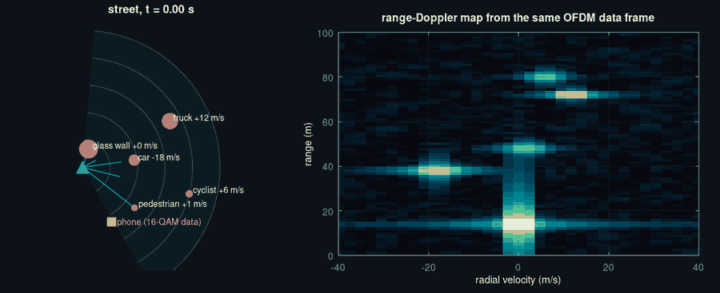
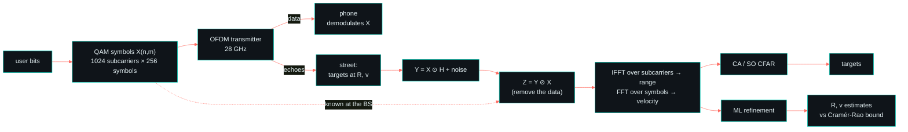
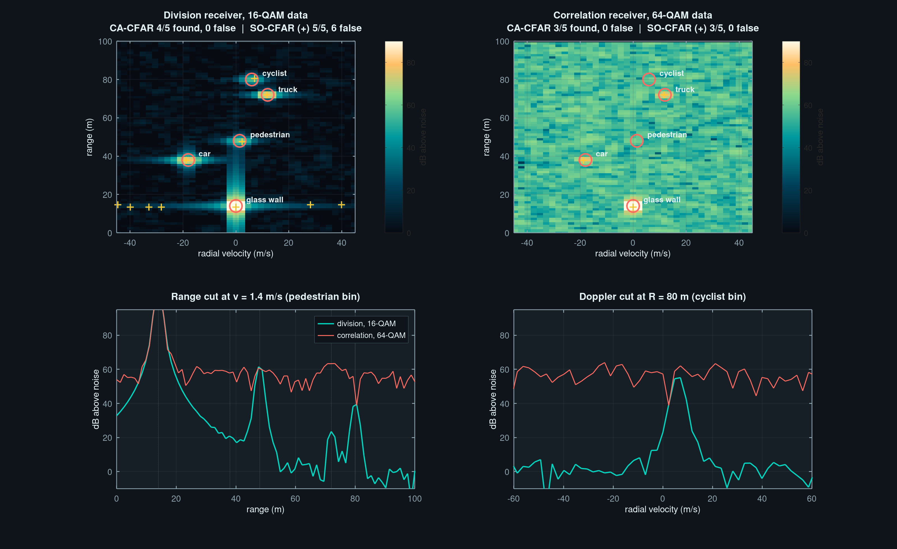
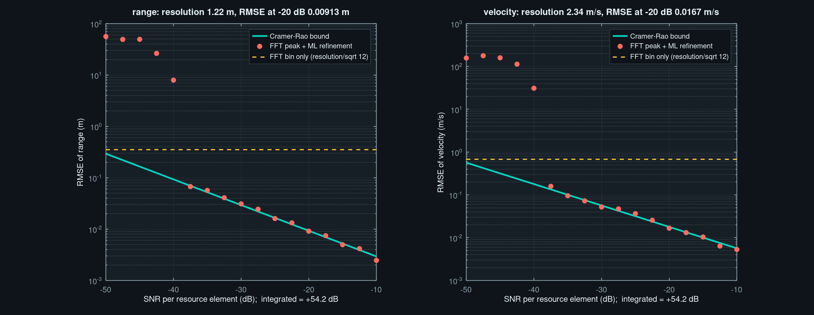
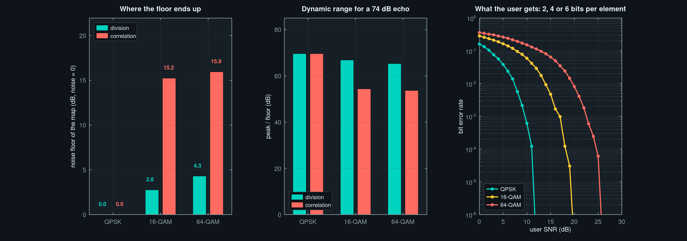
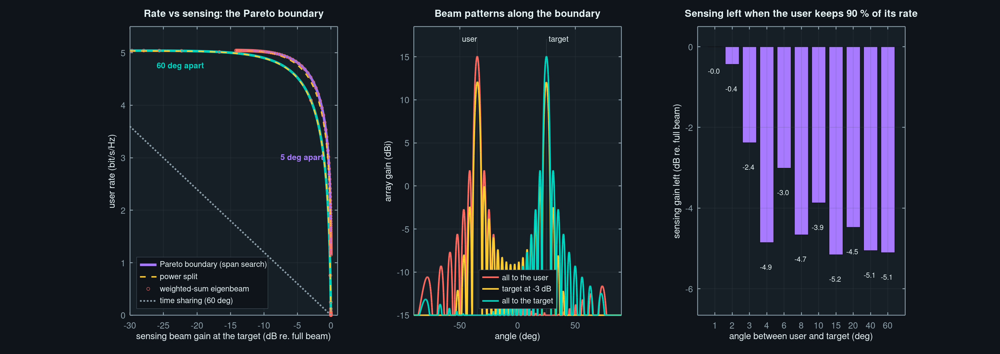
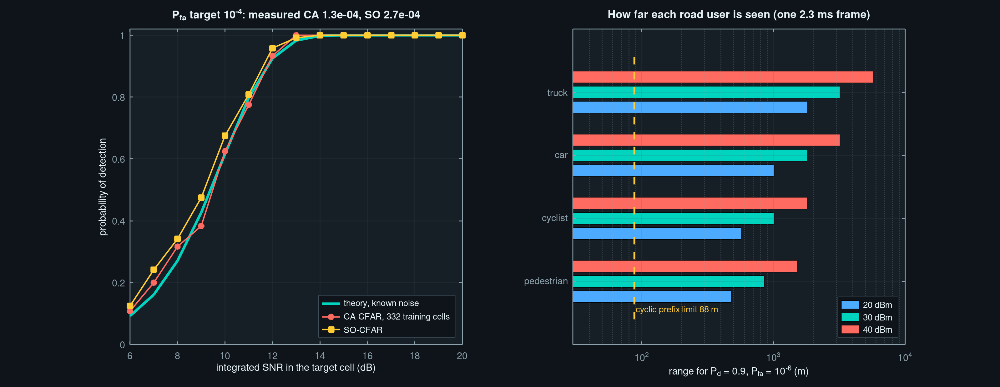
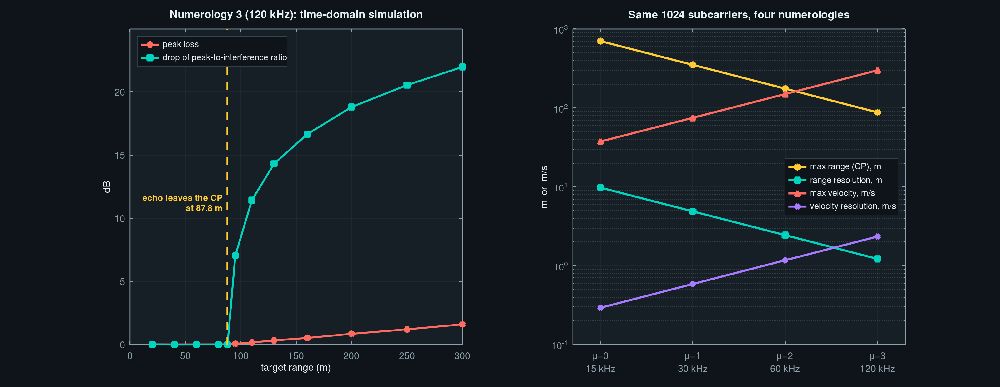

<p align="center"></p>

<p align="center">


</p>

<h3 align="center">A 6G base station should not need a separate radar.<br>The OFDM frame that carries a user's data already contains everything needed to see the street.</h3>

**Integrated sensing and communication (ISAC)** is one of the headline features of 6G. The idea: a base station transmits ordinary OFDM data to a phone; the same waves also reflect off cars, people and buildings. Since the base station knows exactly what it sent, it can treat its own data frame as a radar pulse and compute where every reflector is and how fast it moves.

This repository builds that system from the ground up in MATLAB, with 5G NR parameters (28 GHz, 120 kHz subcarriers, 1024 × 256 frame), and answers the practical questions:

* how to get a clean radar image from a frame full of random user data,
* how accurately range and velocity can be measured (against the Cramér-Rao bound),
* what the data modulation costs the radar, and what the radar costs the user,
* how one antenna array splits its beam between a user and a target,
* how far pedestrians, cyclists, cars and trucks can be detected,
* and why the cyclic prefix sets the maximum sensing range.

<table>
<tr>
<td align="center" width="25%"><h2>1.02</h2><sub>RMSE / Cramér-Rao bound for range<br>(0.99 for velocity) above −35 dB<br>per resource element</sub></td>
<td align="center" width="25%"><h2>9 mm</h2><sub>range error at −20 dB per element<br>with 1.22 m resolution:<br>130× finer than one FFT bin</sub></td>
<td align="center" width="25%"><h2>15.2 dB</h2><sub>noise floor added by 16-QAM data<br>to a correlation receiver;<br>division costs only 2.8 dB</sub></td>
<td align="center" width="25%"><h2>88 m</h2><sub>sensing range set by the<br>cyclic prefix at 120 kHz;<br>beyond it, −22 dB at 300 m</sub></td>
</tr>
</table>

<p align="center"></p>
<p align="center"><sub>Each frame on the right is computed from one 2.3 ms 16-QAM data frame: the bright spots are the glass wall (0 m/s), the approaching car, the pedestrian and the truck. The cyclist at 80 m is 22 dB weaker than the truck next to it.</sub></p>

---

## ◆ Run it

```matlab
>> main                          % MATLAB R2016b or newer, no toolboxes
```
```bash
octave --no-gui --eval main      # GNU Octave 6 or newer
```

About 5 minutes. `main` writes six figures to [`figures/`](figures), every number behind them as CSV to [`results/`](results) and a one-page [`results/summary.txt`](results/summary.txt). The figures and numbers on this page come from running this exact code in **GNU Octave 10.3**; the code uses only base functions (`fft`, `ifft`, `conv2`, `eig`, `besseli`, `erfc`), so it runs unchanged in MATLAB.



## ◆ The model, in four lines

After the cyclic prefix is removed, a point target at range $R$ with radial velocity $v$ multiplies each resource element by a phase ramp:

$$Y(n,m) = X(n,m)\sum_k a_k\, e^{-j2\pi n\Delta f\,\tau_k}\, e^{\,j2\pi m T_s f_{D,k}} + W(n,m),\qquad \tau_k=\tfrac{2R_k}{c},\quad f_{D,k}=-\tfrac{2v_k}{\lambda}$$

so dividing by the known data, $Z = Y \oslash X$, leaves a sum of 2-D complex sinusoids: an IFFT over subcarriers gives range, an FFT over symbols gives velocity. The echo amplitude comes from the radar equation ($P_t$ = 30 dBm, 20 dBi array gain each way, 8 dB noise figure, noise over the full 122.88 MHz):

$$\mathrm{SNR}_{\mathrm{RE}} = \frac{P_t G^2 \lambda^2 \sigma}{(4\pi)^3 R^4\, kTFB}$$

| Quantity | Formula | Value (μ = 3) |
|:--|:--|--:|
| range resolution | $c / 2B$ | 1.22 m |
| velocity resolution | $\lambda / (2 M T_s)$ | 2.34 m/s |
| max unambiguous velocity | $\pm\lambda / 4T_s$ | ±300 m/s |
| sensing range inside the cyclic prefix | $c\,T_{cp} / 2$ | 87.8 m |
| processing gain | $10\log_{10}(NM)$ | 54.2 dB |

## ◆ Results

### 1 · A street seen through a data frame

<p align="center"></p>

Five road users at 28 GHz, from a 300 m² glass wall at 14 m (116 dB integrated SNR) down to a cyclist at 80 m (61 dB): a 55 dB dynamic range.

* **Division receiver** ($Y \oslash X$): the data disappears and the floor stays at the thermal noise (median +1.1 dB). With a cell-averaging CFAR it finds 4 of 5: the **cyclist is masked by the truck** 8 m away, whose cells fall in its training window. A smallest-of CFAR (each half of the range window averaged separately) finds all 5, at the price of 6 false alarms along the range sidelobe ridge of the glass wall.
* **Correlation receiver** ($Y \cdot X^*$, the matched filter): with 64-QAM the random amplitudes of the data leave a floor 56 dB above noise, 60 dB below the wall. **The pedestrian and the cyclist vanish under it** (bottom panels).

### 2 · How accurate? As accurate as theory allows

<p align="center"></p>

The bound for one target with unknown complex amplitude ([`crb_rv.m`](src/crb_rv.m)):

$$\sigma_R \ge \frac{c}{2}\left[2\,\mathrm{SNR}\,(2\pi\Delta f)^2 M\,\frac{N(N^2-1)}{12}\right]^{-1/2},\qquad \sigma_v \ge \frac{\lambda}{2}\left[2\,\mathrm{SNR}\,(2\pi T_s)^2 N\,\frac{M(M^2-1)}{12}\right]^{-1/2}$$

The estimator takes the FFT peak and refines it by maximising the 2-D periodogram with shrinking parabolic steps ([`refine_peak.m`](src/refine_peak.m)). Over 60 trials per point, its RMSE is **1.02 × the bound in range and 0.99 × in velocity** from −37.5 dB to −10 dB per resource element. Below −40 dB the noise peaks start to win (the threshold effect) and the error jumps to tens of metres. At −20 dB per element (34 dB integrated) the error is **9 mm and 1.7 cm/s**, while one FFT bin alone would give 35 cm and 68 cm/s.

### 3 · What the user's data costs the radar

<p align="center"></p>

| Data | Division: SNR loss (theory $10\log E[1/\lvert x\rvert^2]$) | Correlation: data floor (theory) | User: SNR for BER 10⁻³ | Rate on 1024 subcarriers |
|:--|--:|--:|--:|--:|
| QPSK | 0.0 dB (0.0) | 0.0 dB (0.0) | 10 dB | 0.23 Gb/s |
| 16-QAM | 2.76 dB (2.78) | 15.2 dB (15.2) | 17 dB | 0.46 Gb/s |
| 64-QAM | 4.30 dB (4.30) | 15.9 dB (15.9) | 23 dB | 0.69 Gb/s |

for an echo of 20 dB per element. The correlation floor grows with the echo (it is $\mathrm{Var}(|x|^2)$ times the echo power), so a strong reflector hides weak ones; the division floor grows only with noise. Simulated and theoretical values agree to 0.02 dB.

### 4 · One array, two beams

<p align="center"></p>

A 32-element array serves a user at −35° and illuminates a target at +25°. The exact Pareto boundary is found by searching the span of the two steering vectors ([`pareto_span.m`](src/pareto_span.m)).

* With the target at half its full beam gain (−3 dB), the user keeps **4.10 bit/s/Hz of 5.04** when they are 60° apart and 4.53 when they are 5° apart.
* For two line-of-sight directions, **a simple power split between the two beams is within 0.08 bit/s/Hz of optimal**, and so is the weighted-sum eigenbeam. Fancy optimisation pays off with more targets or richer channels, not here.
* When the user keeps 90 % of its rate, the target keeps between 0 dB (1° apart, one beam serves both) and −5.2 dB. The curve is not monotonic: at 6° and 10° the target sits on a sidelobe of the user's beam and gets light for free.

### 5 · Detection: who is seen, and how far

<p align="center"></p>

* The CFAR detectors need **11.8 dB** (CA, 332 training cells) and 11.6 dB (SO) of integrated SNR for P<sub>d</sub> = 0.9 at a design P<sub>fa</sub> of 10⁻⁴; theory with perfectly known noise also gives 11.8 dB. Measured false-alarm rates on 3.1 million noise-only cells: 1.3 × 10⁻⁴ (CA) and 2.7 × 10⁻⁴ (SO; the formula for its threshold is approximate).
* At P<sub>fa</sub> = 10⁻⁶ the link budget sees a pedestrian at **850 m** and a car at 1.8 km with 30 dBm. That range is meaningless here: the cyclic prefix stops the sensing at **88 m** (gold line), the real limit at 120 kHz. The radar is never short of power at street ranges; it is short of cyclic prefix.

### 6 · The cyclic prefix sets the range

<p align="center"></p>

This experiment builds the time-domain signal with cyclic prefix and delays the echo sample by sample ([`exp6_numerology.m`](experiments/exp6_numerology.m)). Up to 87.8 m the peak-to-interference ratio is a flat 73.7 dB. One step beyond the cyclic prefix it falls by 7 dB, and by **22 dB at 300 m**, from inter-symbol and inter-carrier interference. Smaller subcarrier spacing buys range but costs resolution:

| Numerology | Δf | Bandwidth (1024 SC) | Range res. | CP range | Velocity res. | Max velocity |
|:--|--:|--:|--:|--:|--:|--:|
| μ = 0 | 15 kHz | 15.4 MHz | 9.76 m | 703 m | 0.29 m/s | ±37.5 m/s |
| μ = 1 | 30 kHz | 30.7 MHz | 4.88 m | 351 m | 0.59 m/s | ±75 m/s |
| μ = 2 | 60 kHz | 61.4 MHz | 2.44 m | 176 m | 1.17 m/s | ±150 m/s |
| μ = 3 | 120 kHz | 122.9 MHz | 1.22 m | 88 m | 2.34 m/s | ±300 m/s |

## ◆ What is modelled, and what is not

* **Monostatic, full duplex.** The base station receives its own echoes while it transmits; self-interference cancellation is assumed perfect.
* **Point targets, free space.** Radar cross-sections are textbook values (pedestrian 0.5 m², car 10 m², truck 100 m²), with no fluctuation (Swerling 0), no multipath and no clutter except the glass wall.
* **Doppler inside one OFDM symbol is neglected** (inter-carrier interference from motion). At 30 m/s (108 km/h) the Doppler shift is 5.6 kHz, 4.7 % of the subcarrier spacing.
* **Every number comes from GNU Octave 10.3.** No MATLAB licence was available on the build machine; the code avoids toolbox and version-specific functions so the results transfer.

## ◆ Repository map

```
isac-ofdm-joint-radar-comm-matlab/
├── main.m                   runs everything (about 5 min)
├── src/
│   ├── isac_params.m        5G NR numerology, link budget
│   ├── qam_mod.m, qam_demod.m   Gray-coded square QAM
│   ├── radar_channel.m      frequency-domain echo model
│   ├── echo_snr.m           radar equation
│   ├── scene.m              street with five road users
│   ├── rd_map.m             range-Doppler periodogram (division / correlation)
│   ├── refine_peak.m        maximum-likelihood refinement
│   ├── crb_rv.m             Cramér-Rao bounds
│   ├── cfar2d.m             CA- and SO-CFAR
│   ├── marcum_q1.m          detection theory
│   ├── ula.m, pareto_span.m beamforming
│   └── palette.m, style_axes.m, ...   figure style
├── experiments/             exp1 … exp6, make_frames.m (GIF)
├── figures/                 six figures
├── results/                 CSV per experiment + summary.txt
└── assets/                  hero.svg, street.gif
```

## ◆ References

1. C. Sturm and W. Wiesbeck, "Waveform design and signal processing aspects for fusion of wireless communications and radar sensing," *Proc. IEEE*, vol. 99, no. 7, 2011.
2. F. Liu *et al.*, "Integrated sensing and communications: toward dual-functional wireless networks for 6G and beyond," *IEEE JSAC*, vol. 40, no. 6, 2022.
3. 3GPP TS 38.211, *NR; Physical channels and modulation* (numerologies and cyclic prefix).
4. M. A. Richards, *Fundamentals of Radar Signal Processing*, 2nd ed., McGraw-Hill, 2014 (CFAR, detection).
5. S. M. Kay, *Fundamentals of Statistical Signal Processing: Estimation Theory*, Prentice Hall, 1993.

## ◆ Licence

MIT © Eng. Jaafar Salim
